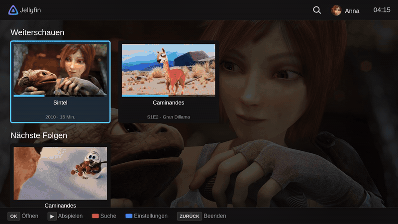
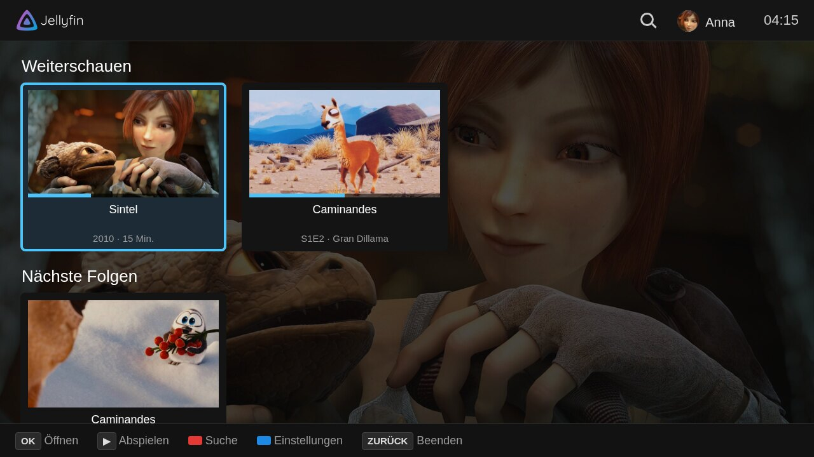
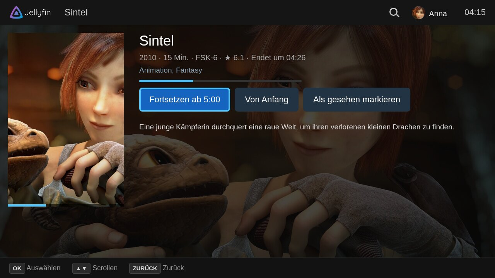
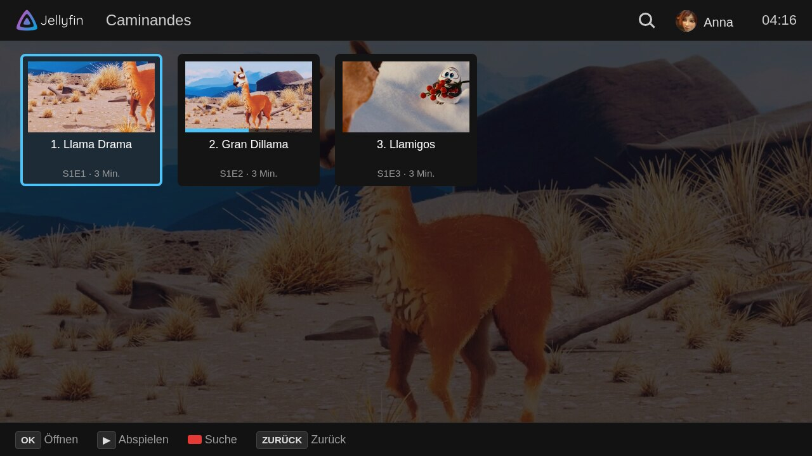
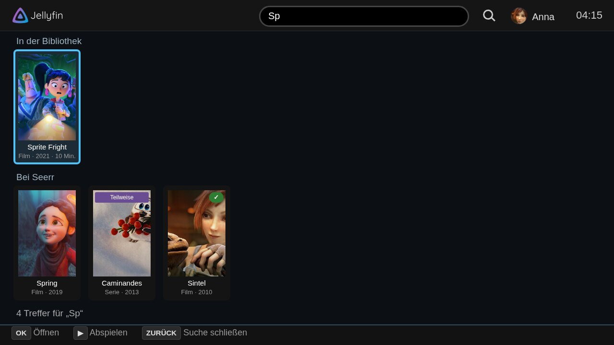
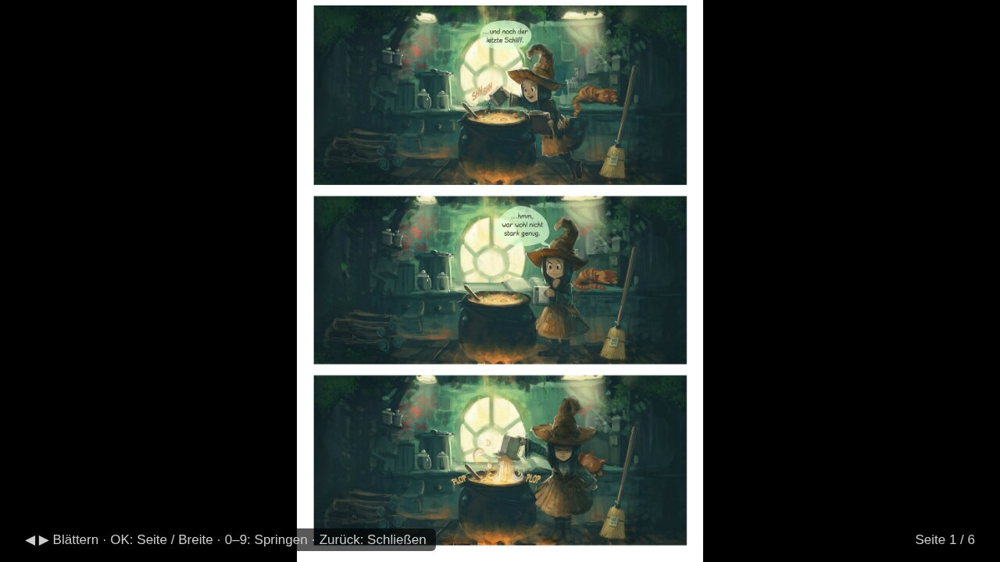
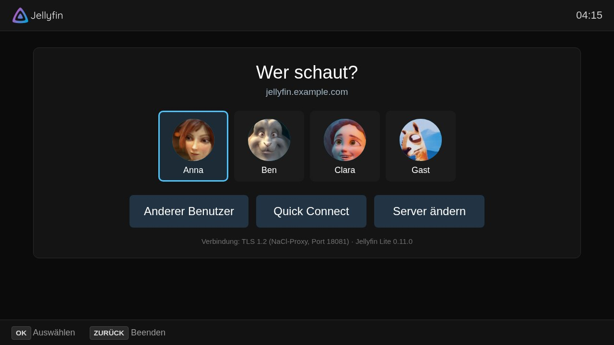

# Jellyfin Lite

A Jellyfin client for older Samsung TVs with Tizen 2.3, written for the TV
remote.



| | |
| --- | --- |
|  |  |
|  |  |
|  |  |

Images in the screenshots: [Blender open movies](https://studio.blender.org/films/)
© Blender Foundation (CC BY), [Pepper & Carrot](https://www.peppercarrot.com)
© David Revoy (CC BY 4.0).

## Features

- Movies and series: continue watching, next episodes, watched state, resume
- Playback with the TV's own player (AVPlay); files with unsupported audio
  (E-AC3, TrueHD, …) are transcoded by the server
- Player options: subtitles, audio track, speed, picture format; seeking with
  preview images
- Next episode starts automatically
- Search in the top bar; with [Seerr](https://github.com/seerr-team/seerr),
  titles that aren't in the library can be requested from there
- Books: comics (CBZ, CBR), EPUB and PDF, read page by page without
  downloading the whole file
- Book and home video libraries are browsed by folder
- Big libraries: jump to a letter with the number keys (7 = P Q R S)
- In the TV's language: English, German, French, Spanish, Italian, Dutch,
  Polish and Portuguese (other languages get English)
- Optional backdrops and a calmer display mode for TVs whose brightness
  jumps between dark and bright screens

Planned: see [TODO.md](TODO.md).

## How it connects

The TV's browser only supports TLS 1.0. Jellyfin Lite ships a Native Client
module that speaks TLS 1.2 and passes the app's requests to the server. The
same module unpacks comic archives and renders PDF pages. Details are in
[native/README.md](native/README.md).

Servers on the home network that use plain `http://` also work without the
module.

## Requirements

- Samsung TV with Tizen 2.3 in developer mode, with your PC's IP set as host
- A Samsung author and distributor certificate (free, see [INSTALL.md](INSTALL.md))
- [Nix](https://nixos.org) with flakes, or Tizen Studio for the release package
- A Jellyfin server, reachable over HTTPS (certificate from a public CA) or
  over HTTP in the home network

## Install

See [INSTALL.md](INSTALL.md) for developer mode, certificates and
installing without Nix. In short, with the certificates in `certs/`:

```bash
nix run . -- 192.168.1.50   # IP of the TV; it is remembered in .tv-ip
```

On first start the app asks for the server address.

Other commands:

| Command | Does |
| --- | --- |
| `nix run .#sign` | create `JellyfinLite-signed.wgt` |
| `nix run .#native` | rebuild the NaCl module into `native/dist/` |
| `nix run .#test-books -- a.cbr b.pdf` | test archive and PDF reading on the PC |
| `nix build` | unsigned package, for signing with Tizen Studio |
| `nix develop` | shell with all of the above and `sdb` |

The [releases](https://github.com/Grumm3l/jellyfin-lite/releases) contain the
unsigned package.

## TV remote

| Key | Browsing | Player |
| --- | --- | --- |
| Arrows | move (▲ at the top: search, profile) | ◀ ▶ seek, ▲ ▼ show progress |
| OK | open | pause / resume |
| ▶ / ▶❚❚ | play | pause / resume |
| ◀◀ / ▶▶ | – | seek 30 s |
| 0–9 | jump to a letter (A–Z sorting) | jump to 0–90 % |
| CH ▲ / CH ▼ | three rows up / down | next / previous episode |
| Red | search | – |
| Green | only unwatched | – |
| Yellow | sort order | – |
| Blue | settings | playback options |
| Back | back (twice on the home screen: exit) | stop |

Comics: ◀ ▶ turn pages, OK switches between whole page and full width.
EPUB: ◀ ▶ pages, ▲ ▼ chapters, OK font size.

## Notes

- Seeking in a transcoded file restarts the transcode, so it takes a moment.
- Image subtitles (PGS, DVD) are not supported.
- AVPlay on Tizen 2.3 only plays whole-number speeds (1×, 2×, 4×).
- Reading books needs the "allow downloads" permission for the Jellyfin user.

## Project layout

| Path | Content |
| --- | --- |
| `app.js`, `index.html`, `style.css` | the app |
| `i18n.js` | translations (the texts in `app.js` are German) |
| `config.xml` | Tizen widget manifest |
| `native/` | NaCl module: source, prebuilt `dist/` |
| `nix/` | Nix packages: NaCl SDK, module, sdb, PC test |
| `tools/tizen-sign.js` | writes the widget signatures |
| `flake.nix` | build, sign and install commands |
